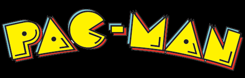

<p align="center">
  
</p>

<h1 align="center">PACman · Java y programación orientada a objetos</h1>
<p align="center"><strong>Java 17 · libGDX 1.11.0 · Gradle 7.5.1 · JUnit 5 · Mockito</strong></p>

Proyecto académico de la asignatura de Diseño y programación orientada a objetos de la **Universitat Oberta de Catalunya (UOC)**. Un juego de escritorio sirve como contexto para trabajar el modelado de entidades, las interfaces, la herencia y los comportamientos de los personajes.

**English:** Academic Java desktop game project built with libGDX. The repository contains the game model, controller and screens, several ghost behaviours, and JUnit tests. It includes UOC-provided code and coursework contributions.

## Para quien revisa el proyecto

| Qué explorar | Dónde |
| --- | --- |
| Organización del modelo y sus entidades | [`model`](core/src/main/java/edu/uoc/pacman/model) |
| Abstracción de comportamientos de persecución | [`ghosts/chase`](core/src/main/java/edu/uoc/pacman/model/entities/characters/ghosts/chase) |
| Creación de fantasmas según el tipo | [`GhostFactory.java`](core/src/main/java/edu/uoc/pacman/model/entities/characters/ghosts/GhostFactory.java) |
| Coordinación de la partida | [`Game.java`](core/src/main/java/edu/uoc/pacman/controller/Game.java) |
| Pantallas y entrada del usuario | [`view`](core/src/main/java/edu/uoc/pacman/view) |
| Comprobaciones del modelo y de su estructura | [`core/src/test/java`](core/src/test/java/edu/uoc/pacman) |

El código permite explorar el patrón Strategy mediante `ChaseBehaviour` y sus implementaciones, y una factoría simple para crear fantasmas. Estas estructuras forman parte del proyecto académico compartido con la UOC; su presencia no implica que toda la arquitectura sea de autoría propia.

## Requisitos

- JDK **17**. Comprueba `java -version` y `javac -version`.
- Git y acceso a Internet para que el wrapper descargue Gradle y las dependencias en la primera ejecución.
- Entorno gráfico para jugar. Las pruebas no necesitan abrir la ventana del juego.

Se incluye Gradle Wrapper; no es necesario instalar Gradle por separado. La distribución fijada es 7.5.1.

## Ejecutar

```bash
git clone https://github.com/Rpfdeveloper/PACman.git
cd PACman
```

**Windows PowerShell**

```powershell
.\gradlew.bat desktop:run
```

**Linux / macOS**

```bash
bash gradlew desktop:run
```

El arranque de escritorio ya contempla el argumento de JVM específico de macOS en su tarea Gradle.

### Controles

- **Enter:** comenzar desde la pantalla de bienvenida.
- **Flechas:** cambiar la dirección de Pacman. La implementación actual procesa el cambio al soltar la tecla.

## Pruebas

**Windows PowerShell**

```powershell
.\gradlew.bat core:test
.\gradlew.bat core:testSanityBasic
```

**Linux / macOS**

```bash
bash gradlew core:test
bash gradlew core:testSanityBasic
```

También existen las tareas `core:testSanity`, `core:testBasic`, `core:testAdvanced` y `core:testExpert`, que seleccionan las etiquetas definidas en el material del proyecto. Los informes de pruebas se generan dentro de `core/build/reports/tests/`.

**Estado de verificación:** se han revisado las tareas Gradle y las rutas documentadas. En esta revisión no se ha ejecutado la suite ni validado el juego gráficamente; la existencia de los tests no acredita que todos pasen.

## Estructura

| Carpeta | Contenido |
| --- | --- |
| `core/src/main/java` | Modelo, controlador y pantallas. |
| `core/src/test/java` | Tests JUnit y comprobaciones de estructura. |
| `desktop` | Lanzador de escritorio y tareas de ejecución. |
| `assets/images` | Recursos gráficos. |
| `assets/levels` | Tres archivos de niveles. |
| `core/docs` | Documentación Javadoc incluida en el repositorio. |

## Contexto académico y autoría

Práctica académica publicada por [Roberto Pajuelo](https://github.com/Rpfdeveloper). El repositorio contiene código base, recursos y pruebas de la UOC junto con contribuciones del alumno. Los comentarios y Javadoc conservan las atribuciones originales, incluidas las de David García Solórzano y UOC.

No se presenta como un juego comercial ni como un desarrollo íntegramente original. Los recursos gráficos y materiales docentes conservan los derechos de sus titulares.
